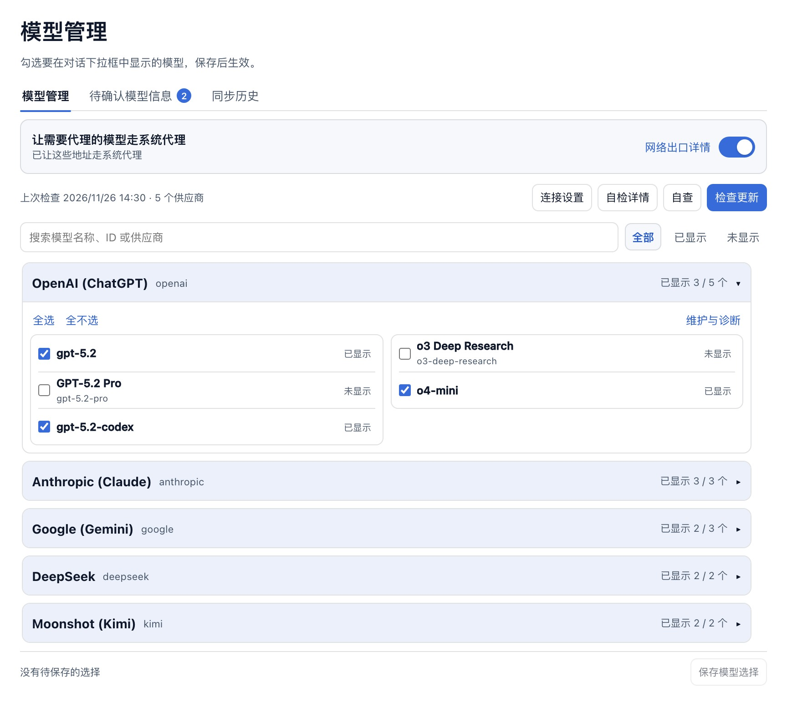
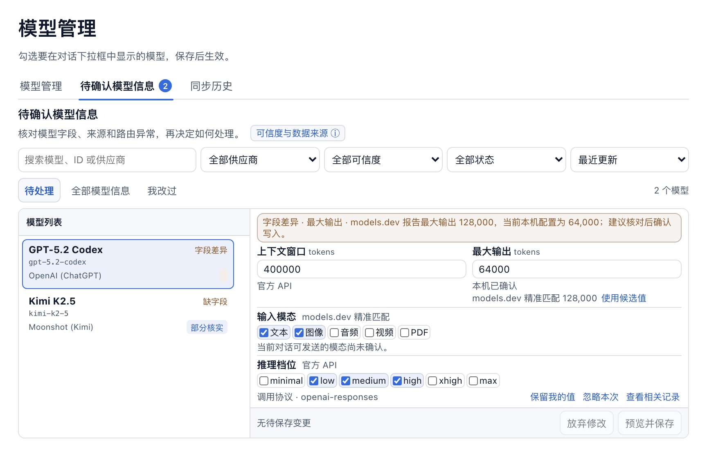
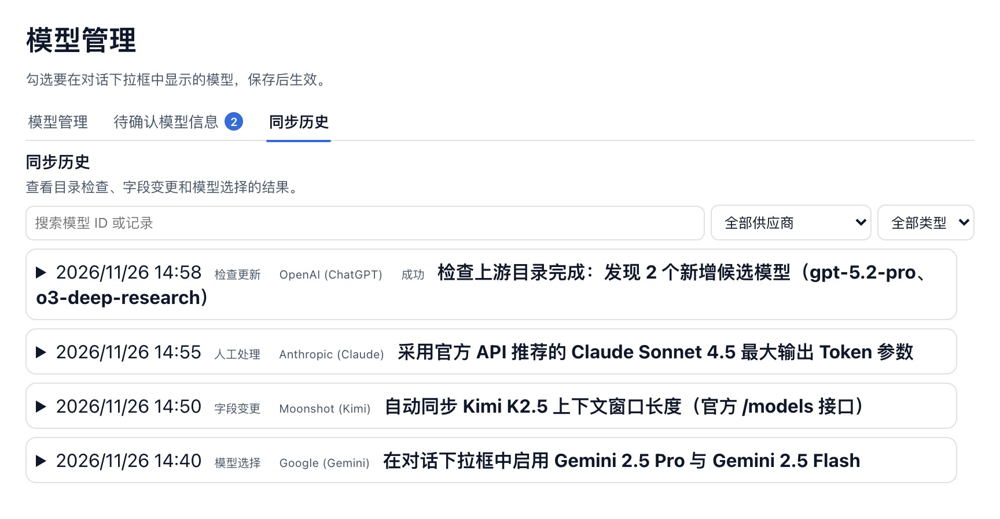

# dsh-model-sync (`dsh-model-sync-plugin`)

**DeepSeek Harness (DSH) 模型目录自动同步、参数校准与下拉框显示管理插件。**  
*Auto-discover upstream LLM catalogs, calibrate model metadata (`contextWindow`, `maxTokens`, multimodal inputs, reasoning efforts), and curate which models appear in your DSH chat selector.*

[](./package.json)
[](./package.json)
[](./package.json)

---

## 🔍 什么时候需要这个插件？（用户与 AI Agent 检索指南）

如果你（或你的用户）在 DeepSeek Harness 中遇到以下任一场景，这个插件就是为此设计的：

- **「OpenAI / Claude / Gemini / Kimi / DeepSeek 出新模型了，怎么在 DSH 里用上？」**  
  自动向已配置供应商的上游接口询问最新模型目录，无需手动翻文档查 Model ID。
- **「聊天输入框里的模型下拉菜单太长了，怎么隐藏不用的旧模型？」**  
  提供可视化的勾选面板，勾选哪个模型，对话下拉框就只显示哪个模型。
- **「为什么这个模型发不了图片 / 上下文被截断 / 没有思考档位（Reasoning Effort）？」**  
  自动结合**官方 API** 与 **[models.dev](https://models.dev)** 核对每个模型的上下文窗口（`contextWindow`）、最大输出（`maxTokens`）、输入模态（文本/图片/音频/视频/PDF）与推理档位（`low`/`medium`/`high` 等）。
- **「海外模型（OpenAI / Claude / Gemini）需要走系统代理，国内模型直连，怎么配？」**  
  内置**系统代理智能分流开关**，只让需要代理的上游域名走本机系统代理，不影响直连厂商。
- **「供应商只支持某种特定协议（如 OpenAI Responses / Google Gemini / Anthropic），DSH 调用报错怎么办？」**  
  内置**本机回环协议转换网关**（`127.0.0.1`），在本地自动完成协议适配与模型参数注入。

> **🤖 Keywords for AI Agent Discovery (`plugin_market` / Search)**  
> `dsh-model-sync`, `model catalog sync`, `update model list`, `hide models in selector`, `filter model dropdown`, `contextWindow`, `maxTokens`, `reasoningEfforts`, `multimodal input`, `models.dev`, `system proxy routing`, `local protocol gateway`, `模型同步`, `模型管理`, `更新模型列表`, `隐藏下拉框模型`, `上下文窗口配置`, `系统代理分流`, `协议转换网关`.

---

## 💡 它解决什么痛点？（小白也能看懂的对比）

| 常见痛点 | 没有插件时的传统做法 | 安装 `dsh-model-sync` 后的体验 |
| :--- | :--- | :--- |
| **新模型上线慢** | 手动去官网翻 API 文档、复制一长串模型 ID、手改配置文件，改错一个标点就报错 | 点击 **「检查更新」**（或每天定时自动检查），新模型自动出现在列表中，按需启用 |
| **下拉菜单太臃肿** | 一个厂商动辄三四十个历史快照模型，全挤在聊天选择框里，找常用模型像大海捞针 | 在 **「模型管理」** 里像列购物清单一样打勾——只把你常用的主力模型留在对话下拉框 |
| **模型参数拿不准** | 不知道新模型最大支持多少 Token、能不能看图、支持哪些推理档位，只能盲填 | 自动比对**官方接口**与 **models.dev**，发现参数冲突或缺漏时在 **「待确认模型信息」** 高亮提醒，一键采用候选值 |
| **网络与协议折腾** | 海外接口直连超时，或者厂商接口协议与宿主默认协议不一致导致无法对话 | 一键开启 **「让需要代理的模型走系统代理」**，配合本地回环网关自动搞定协议转换 |
| **怕改坏本地配置** | 手改 `config.yml` 怕把原有的 API Key 或其他配置冲掉 | **安全铁律**：只更新已配置供应商下的模型清单，**绝不擅自新增供应商键**；每次写入前自动备份快照，随时一键回滚 |

---

## 📸 功能演示截图

### 1. 模型管理与系统代理分流（勾选对话下拉框可见模型）

在 **「模型管理」** 页签中，你可以一眼看到所有已配置的供应商（如 OpenAI、Anthropic、Google、DeepSeek、Moonshot Kimi 等），展开后直接勾选要在聊天输入框下拉菜单里显示的模型，并一键开启系统代理分流：



### 2. 待确认模型信息（官方 API 与 models.dev 参数核对）

当上游或 `models.dev` 的模型参数（上下文窗口、最大输出 Token、支持模态、推理档位）与本机不一致，或新发现的模型缺少关键字段时，插件不会盲目覆盖你的配置，而是放进 **「待确认模型信息」** 供你对比来源并一键确认：



### 3. 同步历史（全链路变更留痕）

所有目录检查结果、新发现的候选模型、自动或人工确认的参数修改，都会在 **「同步历史」** 中按时间轴清晰记录，方便随时回溯：



---

## ✨ 核心特性与安全边界

1. **绝不越界修改供应商配置**：
   - 插件只读取你已经在 DSH 中配好的 `providers.<route>`，只在该供应商下维护模型目录与可见性，**永远不会偷偷新增未授权的 `providers.*` 条目**。
   - 你从未交给插件托管的供应商，它的 `models` 字段保持原样不动。
2. **多源元数据交叉核验（三级可信度）**：
   - 综合比对**供应商官方 API**、**[models.dev](https://models.dev)** 社区模型库与**本机已确认配置**。
   - 自动标注可信度（`已核实` / `部分核实` / `字段差异` / `低可信度`），你手工改过并确认的值会被锁定保护，不会被后续自动同步冲掉。
3. **本机协议转换网关（`127.0.0.1`）**：
   - 针对需要 `openai-responses`、`google-generative-ai` 等原生协议或特定推理档位参数的路由，在本地回环端口自动完成协议适配，不经过任何第三方中转服务器，API Key 始终只发往你配置的官方/上游地址。
4. **快照保护与一键回滚**：
   - 每次写回宿主配置前，自动在 `~/.dsh/model-sync/snapshots/` 保存变更前快照；如遇上游目录异常，可随时在「维护与诊断」中恢复到变更前状态。

---

## 🔌 支持的供应商与上游协议

| 供应商 / 路由类型 | 自动识别条件 | 目录发现与协议方式 |
| :--- | :--- | :--- |
| **OpenAI (ChatGPT)** | `provider=openai` 或 `api.openai.com` | `/v1/models` + `openai-responses` 协议探测 |
| **Anthropic (Claude)** | `api=anthropic-messages` 或 `api.anthropic.com` | `GET /v1/models`（`x-api-key` + `anthropic-version`） |
| **Google (Gemini)** | `api=google-generative-ai` 或 `googleapis.com` | `GET /v1beta/models`（自动过滤非生成模型并转换 `models/gemini-*`） |
| **DeepSeek** | `api.deepseek.com`（含 `/anthropic` 兼容路径） | 自动回退至根路径 `GET /models` |
| **Moonshot (Kimi) / 通义千问 / 智谱 GLM / MiniMax / xAI (Grok)** | 对应官方 Base URL 或 OpenAI/Anthropic 兼容端点 | 标准 `GET /models` + `models.dev` 元数据补全 |
| **OpenCode Zen / Ollama / 其他兼容网关** | `opencode.ai/zen`、本地 Ollama 或任意 `/v1` 兼容端点 | `GET /models` 目录拉取与本地可见性过滤 |

---

## 🚀 安装与快速上手

### 安装方式

在 DeepSeek Harness 的插件管理中安装，或通过命令行安装到当前 Profile：

```bash
# 从 GitHub 仓库直接安装
dsh plugin add github:chen1pengvincent/dsh-model-sync-plugin

# 或在本地克隆后通过 link 安装
dsh plugin add --link /path/to/dsh-model-sync-plugin
```

### 三步上手

1. 打开 DeepSeek Harness **设置 → 模型管理**（插件设置页）。
2. 如果你使用 OpenAI / Claude / Gemini 等需要代理的服务，打开顶部的 **「让需要代理的模型走系统代理」** 开关，然后点击 **「检查更新」**。
3. 在各厂商卡片下**勾选你想在聊天框里看到的模型**，点击右下角 **「保存模型选择」**；如果 **「待确认模型信息」** 标签带有数字角标，点进去核对并确认推荐的上下文长度或推理档位即可。

---

## 🏗️ 架构说明与本地开发

在 `v3.1.4` 中，插件完成了全面的模块化运行时重构，将职责拆分为高内聚的独立模块（详见 [`docs/architecture.md`](./docs/architecture.md)）：

- [`lib/index.js`](./lib/index.js)：插件入口、HTTP API 路由挂载与生命周期钩子。
- [`lib/service.js`](./lib/service.js)：核心同步编排服务（定时调度、上游探测、操作串行化与持久化）。
- [`lib/gateway.js`](./lib/gateway.js)：本机回环协议转换网关与系统代理探针。
- [`lib/metadata.js`](./lib/metadata.js)：`models.dev` 缓存拉取、多源参数归一化与冲突检测。
- [`lib/host-config.js`](./lib/host-config.js)：宿主 `config.yml` / `bili` 代理配置读写与快照回滚。
- [`lib/view.js`](./lib/view.js)：前端视图状态组装与自检诊断报告生成。
- [`lib/client.js`](./lib/client.js)：设置页前端 UI 与聊天输入框模型选择器过滤脚本。

### 常用开发与验证命令

```bash
# 运行完整单元测试与集成测试套件（420+ 测试用例）
npm test

# 检查本机 DSH Profile 安装状态与启动自检结果（可选）
npm run verify
```

---

## 🌐 English Summary

**`dsh-model-sync`** keeps your configured DeepSeek Harness (DSH) model providers in sync with their upstream model catalogs while giving you full control over selector visibility and model metadata:

- **Pain-free Model Discovery**: Polls `/models` across OpenAI, Anthropic, Google Gemini, DeepSeek, Moonshot Kimi, xAI Grok, Qwen, Zhipu, MiniMax, OpenCode, and Ollama without ever adding unauthorized `providers.*` keys.
- **Clean Chat Model Selector**: Check or uncheck models per provider to keep your chat model dropdown clean and focused.
- **Multi-Source Metadata Verification**: Cross-checks `contextWindow`, `maxTokens`, multimodal input capabilities, and `reasoningEfforts` between official provider APIs and `models.dev`, highlighting discrepancies in a dedicated **Pending Review** tab.
- **Smart System Proxy & Local Protocol Gateway**: Routes proxy-required upstream domains through your system proxy while keeping domestic providers direct, and bridges protocol differences via a local `127.0.0.1` loopback gateway.
